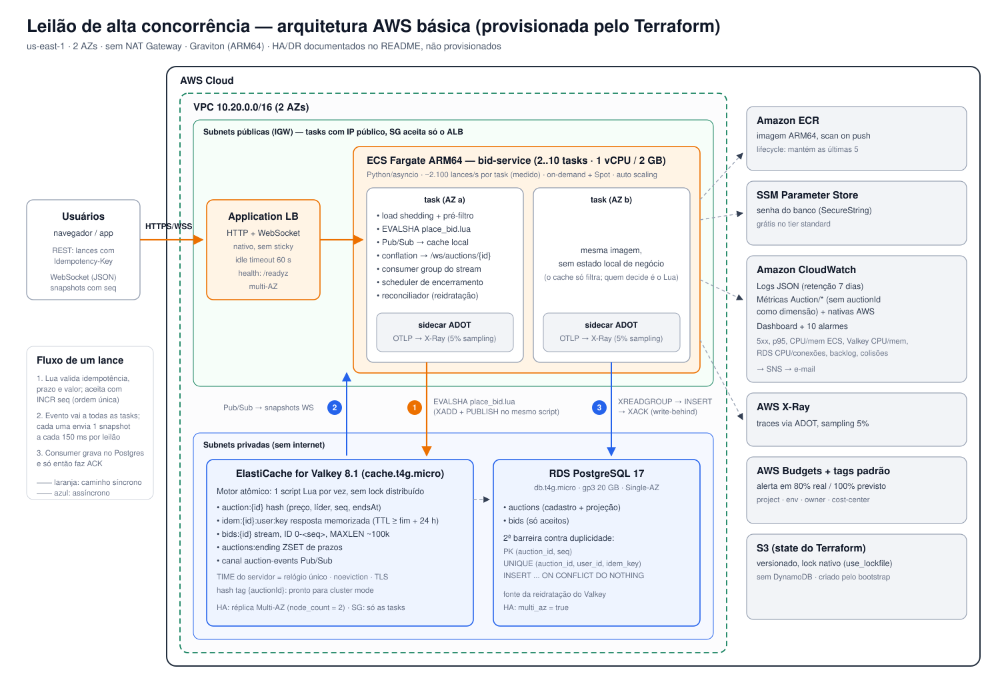

# Leilão online de alta concorrência

Solução para o desafio técnico de Engenharia de Software: um motor de lances que aguenta centenas de milhares de usuários nos últimos segundos de um leilão, com ordem determinística, sem lances inválidos ou duplicados e com atualização em tempo real.

**Stack:** Python 3.13 · FastAPI + uvicorn (asyncio, uvloop) · redis-py · asyncpg · Valkey 8 (Lua, Streams, Pub/Sub) · PostgreSQL 17 · WebSocket · Terraform (AWS: ECS Fargate Graviton, ALB, ElastiCache, RDS) · k6 · pytest + Testcontainers

| Documento | Conteúdo |
|---|---|
| [`docs/decisoes-tecnicas.md`](docs/decisoes-tecnicas.md) | 13 ADRs curtos com o porquê de cada escolha |
| [`docs/finops.md`](docs/finops.md) | Custo da arquitetura, alternativas descartadas e custo do pico |
| [`docs/arquitetura-aws.png`](docs/arquitetura-aws.png) | Desenho da arquitetura AWS (fonte editável em `.svg`) |
| [`load-test/results/`](load-test/results/README.md) | Capacidade medida por task, linearidade e comportamento sob sobrecarga |

---

## 1. O desafio

Transcrição do enunciado recebido.

> **Desafio Técnico – Vaga de Engenheiro(a) de Software**
>
> Olá! Estamos muito felizes com seu interesse em fazer parte do nosso processo! Como parte do nosso processo seletivo, preparamos um desafio técnico que tem como objetivo avaliar sua capacidade de arquitetura, desenvolvimento e tomada de decisão técnica.
>
> **Visão geral do problema.** Em leilões on-line de alta concorrência (como itens raros ou bilhetes disputados), centenas de milhares de utilizadores tentam enviar lances simultâneos nos últimos segundos. O sistema precisa responder em tempo real, garantir ordem determinística de chegada dos lances e evitar que condições de corrida (race conditions) aceitem lances inválidos ou duplicados.
>
> **O que esperamos.** Pense nos cenários e condições reais que esse problema pode envolver. Quanto mais completo você pensar no problema, melhor. Não se limite ao enunciado do problema. Será um diferencial.
> - Um desenho de arquitetura AWS (pode ser feito com ferramentas como Lucidchart, Draw.io ou similar).
> - Código-fonte funcional com instruções claras de como rodar o projeto (pode ser compartilhado um repositório GitHub pessoal ou o envio do código por e-mail).
> - Documentação breve explicando suas decisões técnicas.
>
> **Prazo.** Você terá até o dia da entrevista para entregar sua solução, a partir do momento em que receber este desafio. Obs.: caso não consiga desenvolver o desafio até a data, será desconsiderado do processo.
>
> **Dica.** Se perceber que o prazo está chegando ao fim e não conseguirá concluir, entregue aquilo que fez/pensou! Com parte do desafio realizado, já conseguimos fazer alguma análise e chamar para entrevista, caso classificado!
>
> **Importante.** Este desafio não deve gerar horas extras nem conflitar com suas atividades e compromissos de entregas atuais. Sinta-se à vontade para organizar seu tempo da melhor forma possível dentro desse prazo. Em caso de dúvidas, procure a liderança.

---

## 2. Como a solução atende cada requisito

**A ideia central:** cada lance é decidido por um único script Lua no Valkey (`place_bid.lua`). O Valkey executa um script por vez, então todos os lances de um leilão passam por um ponto atômico, sem lock distribuído.

| Requisito | Como é garantido | Onde |
|---|---|---|
| **Ordem determinística** | `HINCRBY seq` dentro do script: cada lance aceito recebe um número único e contíguo (1, 2, 3...). "Ordem de chegada" = ordem de serialização no Valkey (ver ADR-02). | `place_bid.lua` |
| **Relógio confiável** | Prazo e anti-sniping usam só o `TIME` do Valkey, nunca o relógio do cliente ou da task. | `place_bid.lua`, `RedisClock` (`common.py`) |
| **Sem lance inválido** | Na mesma execução atômica: leilão `OPEN`, dentro do prazo, valor ≥ preço inicial (1º lance) ou ≥ preço atual + incremento. No empate, vence quem chegou primeiro. | `place_bid.lua` |
| **Sem duplicado** | `Idempotency-Key` obrigatório, memorizado por (leilão, usuário, key) com o resultado original, inclusive rejeições. Mesma key com outro valor: `422` (exceto se o original foi rejeitado no pré-filtro por já estar superado, ver ADR-03). A key de um lance aceito vive até o fim do leilão + 24 h. No Postgres, `PK (auction_id, seq)` e `UNIQUE (auction_id, user_id, idempotency_key)`; uma reentrega é ignorada e uma colisão real vai para `bid_conflicts`, com alarme. | `place_bid.lua`, `BidPersister` (`persistence.py`), `migrations/V1`/`V2__*.sql` |
| **Tempo real** | O Lua publica no Pub/Sub; cada task envia snapshots por WebSocket aos seus clientes, consolidados a cada 150 ms (conflation). Prorrogação e encerramento saem na hora. | `realtime.py` |
| **Alta concorrência** | O caminho do lance é 1 script Lua no Valkey (mais o rate limit); o Postgres fica fora dele (write-behind via Redis Streams). Um pré-filtro na task resolve 97% dos lances (os já superados) sem chamar o Lua. Acima da capacidade, a task devolve o excesso como 503 em vez de enfileirar (load shedding). | `bids.py`, `persistence.py`, `LoadShedder` (`app.py`) |

**Além do enunciado:**
- **Anti-sniping:** um lance nos últimos X segundos estende o leilão em Y segundos, configurável por leilão.
- **Reidratação:** se o Valkey perder tudo, o estado é reconstruído do Postgres e o `seq` continua sem colidir.
- **Encerramento idempotente:** com várias tasks, ninguém encerra duas vezes.
- **Rate limit por usuário e por IP:** token bucket por usuário no Valkey (vale entre todas as tasks) e por IP de origem na memória de cada task, porque o `X-User-Id` é declarado pelo cliente e trocá-lo a cada request contornaria o primeiro. A defesa definitiva é autenticação + WAF (seção 9).
- **Degradação controlada:** com o dobro da carga, a task atende o que consegue e devolve o resto como `503` com `Retry-After`, sem erro e sem colapso (ADR-12).
- **Capacidade medida com método** (CPU isolada do gerador de carga, task do tamanho do Fargate, SLO) e o Terraform dimensionado por esse número (ADR-13).
- **Observabilidade completa e FinOps.**

### Fluxo de um lance

```
cliente ── POST /auctions/{id}/bids (X-User-Id, Idempotency-Key) ──► task
  task: load shedding → rate limit (IP, usuário) → pré-filtro (cache local) → EVALSHA place_bid.lua
  Valkey, atômico: idempotência → prazo → valor → INCR seq → XADD stream → PUBLISH evento
  ◄── 201 {seq, preço, próximo mínimo, endsAt}

assíncrono: Pub/Sub → todas as tasks → snapshot WebSocket a cada 150 ms → clientes
            Pub/Sub avisa o consumer → stream → consumer group → INSERT em lote no Postgres → XACK
```

## 3. Arquitetura AWS



O Terraform (`infra/terraform`) provisiona a arquitetura básica:

| Camada | Serviço |
|---|---|
| Rede | VPC 2 AZs, sem NAT (tasks com IP público, SG só aceita o ALB; dados em subnets privadas) |
| Entrada | ALB com WebSocket nativo |
| Compute | ECS Fargate ARM64, tasks de 1 vCPU / 2 GB (~2.100 lances/s cada, medido), 2–10 tasks, base on-demand + Spot, auto scaling por CPU e requests |
| Motor | ElastiCache for Valkey `cache.t4g.micro` (TLS, `noeviction`) |
| Banco | RDS PostgreSQL 17 `db.t4g.micro` |
| Imagens | ECR com lifecycle |
| Segredos | SSM Parameter Store |
| Observabilidade | CloudWatch (logs, métricas, dashboard, 10 alarmes → SNS) e X-Ray via sidecar ADOT |
| Custo | Budget + tags padrão |
| State | S3 com lock nativo |

Custo estimado: **~US$ 128/mês, ou ~US$ 0,18/h** para subir só na demo (ver [`docs/finops.md`](docs/finops.md)).

## 4. Como rodar

### Local (Docker Compose)

Pré-requisitos: Docker com Compose. Para os testes, [uv](https://docs.astral.sh/uv/) (instala o Python 3.13 sozinho).

```bash
docker compose up -d --build        # 2 réplicas + nginx (papel do ALB) + Valkey + Postgres
./scripts/smoke-test.sh             # 14 verificações ponta a ponta contra http://localhost:8080
```

- **Mais réplicas:** `APP_REPLICAS=4 docker compose up -d` (o nginx resolve as réplicas no startup: `docker compose restart nginx`).
- **Observabilidade local:** `docker compose --profile observability up -d` sobe também Prometheus (<http://localhost:9090>), que descobre as réplicas pelo DNS do Docker, e Grafana (<http://localhost:3000>), com o datasource já configurado.

Testes (sobem Valkey e Postgres via Testcontainers; precisam do Docker):

```bash
cd bid-service && uv run pytest
```

### AWS

Implantado em 2026-11-03 numa conta pessoal e deixado **pausado** (ver abaixo). Pré-requisitos: AWS CLI com credenciais, Terraform ≥ 1.10 e Docker. O build ARM64 não precisa de buildx nem QEMU (ver `bid-service/Dockerfile`).

```bash
# 1. Bucket do state (uma vez)
terraform -chdir=infra/terraform/bootstrap init
terraform -chdir=infra/terraform/bootstrap apply -var bucket_name=<bucket-unico>

# 2. Infra base com o ECR (primeiro apply só do repositório)
cd infra/terraform/envs/dev
cp backend.hcl.example backend.hcl            # preencher o bucket
cp terraform.tfvars.example terraform.tfvars  # owner, alert_email, image_tag
terraform init -backend-config=backend.hcl
terraform apply -target=module.ecr

# 3. Imagem ARM64
../../../../scripts/build-push.sh "$(terraform output -raw ecr_repository_url)"   # imprime image_tag

# 4. Restante da infra (~15-20 min: RDS e ElastiCache são os lentos)
terraform apply                                # usa a image_tag do tfvars
../../../../scripts/smoke-test.sh "$(terraform output -raw alb_url)"
uv run --project ../../../../bid-service python ../../../../scripts/ws-check.py "$(terraform output -raw alb_url)"
```

**Pausar e retomar** (para não pagar o ambiente parado entre testes):

```bash
./scripts/aws-pause.sh    # auto scaling travado em 0, tasks em 0, RDS parado
./scripts/aws-resume.sh   # RDS de volta, 2 tasks, auto scaling 2..10 e smoke test (~5-10 min)
```

Pausado, o custo cai para **~US$ 1,1/dia**: o ALB e seus IPv4 e o nó do ElastiCache não têm pausa na AWS, e o disco do RDS continua cobrado. O RDS parado volta sozinho depois de 7 dias (regra da AWS). Custo zero só com `terraform destroy` (o ECR vai junto, com `force_delete`).

## 5. API

| Método | Rota | Descrição |
|---|---|---|
| `POST` | `/auctions` | Cria um leilão. Corpo: `title`, `startingPrice`, `minIncrement`, `durationSeconds`, `antiSnipingWindowSeconds` (padrão 10), `antiSnipingExtendSeconds` (padrão 10) |
| `GET` | `/auctions/{id}` | Estado vivo: preço, líder, `seq`, próximo mínimo, `endsAt`, `serverTime`, vencedor |
| `POST` | `/auctions/{id}/bids` | Lance. Headers obrigatórios: `X-User-Id` (`[A-Za-z0-9_-]{1,64}`), `Idempotency-Key`. Corpo: `{"amount": 150.00}` |
| `GET` | `/auctions/{id}/bids?afterSeq=N&limit=100` | Lances aceitos com seq > N, em ordem (Postgres + stream) |
| WS | `/ws/auctions/{id}` | JSON: `AUCTION_SNAPSHOT` (também logo ao conectar), `AUCTION_EXTENDED` e `AUCTION_CLOSED`, todos com `seq`. Só leitura: mensagem do cliente fecha a conexão (1008); caminho que não é um UUID recebe 403 no handshake |

**Respostas do lance:**

| Status | Quando |
|---|---|
| `201` | Aceito; devolve `seq` |
| `200` | Replay de um lance aceito; header `Idempotent-Replayed: true` |
| `409` | `BID_TOO_LOW` (abaixo do mínimo ou empate) |
| `422` | `AUCTION_CLOSED` ou `IDEMPOTENCY_KEY_REUSED` |
| `429` | Rate limit (por usuário ou por IP) |
| `503` | Task acima da capacidade (`OVERLOADED`) ou Valkey indisponível (`UNAVAILABLE`), com `Retry-After: 1` |
| `400` | Validação |
| `404` | Leilão inexistente |

Valores monetários entram como número ou string (`150.00` ou `"150.00"`) e saem sempre como string com 2 casas, nunca como float. O replay de uma rejeição devolve o mesmo status da resposta original, com `Idempotent-Replayed: true`. Isso refina o plano original, que previa `200` para todo replay, e segue o padrão de APIs de pagamento.

**Exemplos:**

```bash
ID=$(curl -s -X POST localhost:8080/auctions -H 'Content-Type: application/json' \
  -d '{"title":"Ingresso da final","startingPrice":"100.00","minIncrement":"5.00","durationSeconds":120}' | jq -r .id)

curl -i -X POST localhost:8080/auctions/$ID/bids -H 'Content-Type: application/json' \
  -H 'X-User-Id: ana' -H 'Idempotency-Key: 7f1c...' -d '{"amount": 100.00}'

curl -s "localhost:8080/auctions/$ID/bids?afterSeq=0" | jq

# WebSocket: só escutar
npx wscat -c ws://localhost:8080/ws/auctions/$ID
```

**Conflation e lacunas de `seq`:** o snapshot traz o `seq` atual. Pular de `seq=2` para `seq=13` é esperado, porque os lances intermediários foram consolidados. O cliente que precisa de cada lance busca `GET /bids?afterSeq=2`.

## 6. Testes e resultados

### Automatizados (`uv run pytest`: 34 testes, Valkey e Postgres reais)

A sessão de testes sobe Valkey e Postgres em containers e a aplicação inteira num servidor uvicorn em portas aleatórias, no mesmo event loop dos testes.

| Suíte | O que prova |
|---|---|
| `test_bid_rules.py` (12) | 1º lance cobre o preço inicial sem incremento; incremento; empate rejeitado; retry devolve o original; retry de rejeição devolve a mesma rejeição; key reutilizada com outro valor; key com escopo por usuário; lance após o prazo; anti-sniping; pré-filtro respeita retries; rejeição do pré-filtro não trava a key e nunca duplica; valores no teto (15 dígitos em centavos) sem perda de precisão; key de aceite vive até o fim do leilão |
| `test_concurrency.py` (1) | **500 usuários × 20 lances simultâneos (10 mil) + ~1.000 retries concorrentes** em corrotinas: seqs únicos e contíguos; cada lance aceito ≥ anterior + incremento; nenhuma key aceita duas vezes; vencedor correto; Postgres converge com zero violações |
| `test_api.py` (8) | Contrato HTTP (201/200/409/422/400/404, valor como número ou string); métricas e health detalhado só na porta interna, `/readyz` e `/livez` na pública; encerramento com vencedor persistido; `afterSeq` com o consumer parado (lê do stream) e depois do banco; **`afterSeq` com lotes gravados fora de ordem** (não pula seqs); **`FLUSHALL` no Valkey** e reidratação (seq continua em 4 e o preço não volta); WebSocket recebe snapshot e encerramento; **cliente WS que tenta publicar é desconectado e um caminho fora de um leilão é recusado** |
| `test_failure_modes.py` (6) | Lance aceito que colide no Postgres vai para `bid_conflicts` com métrica; Valkey atrás do banco (failover) alcança o banco em vez de reusar seqs; entrada órfã no ZSET de encerramento e membro inválido no SET de streams não travam os outros leilões; **Valkey que perdeu o cache de scripts (`NOSCRIPT`)** continua aceitando lances; **consumer persiste pelo aviso do Pub/Sub em < 1 s e, se o aviso se perder, na varredura** |
| `test_load_shedding.py` (2) | Acima do limite de requisições em andamento, `503` com `Retry-After`, sem bloquear as probes; Valkey indisponível vira `503`, não `500` |
| `test_event_dispatch.py` (1) | Eventos do Pub/Sub são aplicados na ordem de publicação (reidratação seguida de lance) |
| `test_ip_rate_limiter.py` (3) | Unitário: limite por IP independe do `X-User-Id`; reposição; buckets ociosos são descartados; o IP do cliente só é lido do `X-Forwarded-For` quando a conexão vem de um proxy privado |
| `test_emf.py` (1) | As métricas exportadas ao CloudWatch têm exatamente os nomes e dimensões que os alarmes e o dashboard do Terraform consultam |

Correções críticas foram validadas por mutação: com o bug reintroduzido no código, o teste correspondente falha.

### Capacidade (k6, local, com método)

```bash
# Capacidade de uma task do tamanho do Fargate (1 vCPU), subindo a taxa:
APP_CPUS=1 ./load-test/capacity.sh 1 1600 2000 2400
# Linearidade: N réplicas a ~80% da capacidade de cada uma
APP_CPUS=0.5 ./load-test/capacity.sh 6 4800
```

O script isola a CPU: o sistema fica nos núcleos físicos 0–3 e o k6 nos 4–5. Assim o gerador de carga não rouba CPU do sistema medido. Cada réplica é limitada ao tamanho da task (`APP_CPUS`). Para cada taxa há 5 s de aquecimento, descartados, e 30 s medidos. O SLO é p99 < 50 ms, zero erros e zero descartes. Os usuários cobrem o mínimo conhecido (+0 a 2 incrementos) e 5% reenviam a mesma key. Tabelas completas em [`load-test/results/`](load-test/results/README.md).

| Medição | Resultado |
|---|---|
| Capacidade de uma task de **1 vCPU** | **~2.100 lances/s**, p99 de 2,5 ms |
| Capacidade de uma task de 0,5 vCPU | ~1.000 lances/s, p99 de 11,9 ms (throttling da cota do cgroup em rajadas) |
| Linearidade, 6 réplicas de 0,5 vCPU | 5.040 lances/s, p99 de 33 ms, 0 erros |
| Sobrecarga, 2× a capacidade | 0 erros; o excesso vira 503; p99 de 103 ms contra 350 ms sem o limite |
| Pré-filtro | 97,3% dos lances resolvidos na task; 2,75% chegam ao Lua |
| CPU por lance | ~0,35 ms |
| Motor isolado (`valkey-benchmark` no `place_bid.lua`) | ~49,5 mil execuções/s numa thread, p50 de 1,9 ms: o teto de **um** leilão |

- **Dimensionamento:** 10 mil lances/s ÷ (2.100 × 70% de alvo) ≈ **7 tasks de 1 vCPU**, dentro do máximo de 10. Por isso a task é de 1 vCPU / 2 GB e a escala por requisições usa 90 mil req/min por task (ADR-13).
- **Limite da máquina:** com 3 ou mais réplicas de 1 vCPU, elas, o nginx, o Valkey e o Postgres não cabem nos 4 núcleos físicos do sistema e aparecem descartes (4 réplicas a 6.800/s: 0 erros, 3% de 503). Acima disso, só com k6 distribuído contra o ALB.
- **Achados do método:**
  - O healthcheck do Compose em `python -c` travava a task de 0,5 vCPU a cada check (p99 de 64 ms a 400/s; trocado por `bash`, 1 ms).
  - O keep-alive padrão do uvicorn (5 s), menor que o do proxy, gerava 502 raros.
  - O consumer varria todos os streams a cada 20 ms; agora é avisado pelo Pub/Sub.
- **Consistência após a carga:** no Postgres, seqs contíguos, zero violações de incremento e projeção igual ao último lance.

Ryzen x86 não é Graviton ARM: os números locais servem para dimensionar e não substituem um teste na AWS. A extrapolação para o pico está em [`docs/finops.md`](docs/finops.md#3-cenário-de-pico-200-mil-usuários-50-mil-lancess-por-30-s).

## 7. Observabilidade

| Sinal | Local | AWS |
|---|---|---|
| **Logs** | `docker compose logs`: JSON (`JSON_LOGS=true`) com `auctionId`, `userId` e `seq` do contexto da requisição (`contextvars`) | CloudWatch Logs `/ecs/leilao-dev`, retenção de 7 dias, com `trace_id` e `span_id` do OpenTelemetry |
| **Métricas** | `:8081/metrics` (Prometheus; porta interna, fora do nginx/ALB) + Prometheus/Grafana (profile `observability`) | Namespace `Auction` no CloudWatch via Embedded Metric Format: a cada minuto, linhas JSON no stdout que o CloudWatch Logs transforma em métricas, sem `PutMetricData`; mais as métricas nativas de ALB, ECS, ElastiCache e RDS |
| **Traces** | — | Auto-instrumentação OpenTelemetry (FastAPI, redis, asyncpg) → sidecar ADOT → X-Ray, 5% de amostragem |
| **Dashboard e alarmes** | Grafana | Dashboard `leilao-dev` + 10 alarmes → SNS e-mail |
| **Health** | `/readyz` e `/livez` na porta pública (o readiness checa Valkey e Postgres); `:8081/health` com o detalhe por componente | Target group do ALB em `/readyz` |

**Métricas de negócio:**
- `auction.bids{outcome,reason}`
- `auction.lua.latency` e `auction.bid.latency` (histogramas no Prometheus; p50/p95/p99 no CloudWatch)
- `auction.requests.shed`: requisições devolvidas com 503 por excesso de carga
- `auction.stream.backlog`: lances aceitos ainda não persistidos
- `auction.persist.conflicts`: lances aceitos que colidiram no Postgres (ver `bid_conflicts`)
- `auction.websocket.sessions`

**Alarmes (AWS):** 5xx do ALB, p95 > 250 ms, CPU e memória do ECS, CPU do engine e memória do Valkey, CPU e conexões do RDS, backlog do stream e colisões na persistência (dispara no primeiro caso).

## 8. FinOps (resumo)

- **Arquitetura básica:** ~US$ 128/mês; ~US$ 0,52 para 3 h de demo.
- **Escolhas que mais economizam:** sem NAT (−US$ 33/mês), ALB em vez de API Gateway WebSocket (no pico, ~US$ 5 vs ~US$ 2.400 por leilão), Graviton (−20%), Spot no excedente, Valkey em vez de Redis OSS (−20%), RDS em vez de Aurora, SSM em vez de Secrets Manager, logs de 7 dias, traces a 5%, métricas sem alta cardinalidade.
- **No pico (200 mil usuários, 50 mil lances/s):** ~US$ 60 por leilão. O custo dominante é a **saída de dados** dos snapshots, não o compute; as alavancas são o intervalo de conflation, compressão, deltas e CloudFront.

Detalhes em [`docs/finops.md`](docs/finops.md).

## 9. Redundância, falhas e Disaster Recovery

Documentado, não provisionado. Os itens marcados com variável já estão parametrizados no Terraform.

### Alta disponibilidade

| Componente | Hoje | Para HA |
|---|---|---|
| ECS | 2 tasks em 2 AZs, deployment com circuit breaker e rollback | — |
| ALB | Multi-AZ por natureza | — |
| ElastiCache | 1 nó | `redis_node_count = 2`: réplica + failover automático Multi-AZ |
| RDS | Single-AZ | `db_multi_az = true`; ou Aurora com réplicas de leitura |
| Muitos leilões simultâneos | — | ElastiCache cluster mode; o hash tag `{auctionId}` já distribui os leilões entre shards |
| Um leilão quente | Pré-filtro + rate limit | Não escala com shards (uma thread por leilão): nó maior (vertical) |

### Modos de falha

| Falha | Comportamento | Mitigação |
|---|---|---|
| **Valkey cai / reinicia** | Estado reconstruído do Postgres (`NOT_LOADED` → reidratação; reconciliador a cada 30 s). O seq continua de `max(seq)` (testado). | Lances aceitos e ainda não persistidos se perdem. Réplica Multi-AZ reduz a janela; `WAIT 1 <timeout>` **pela aplicação logo após o `EVALSHA`** (o `WAIT` não pode ser chamado dentro do Lua) troca latência por durabilidade; **MemoryDB for Valkey** zera a perda de lance confirmado. O ElastiCache não oferece AOF nas versões atuais |
| **Failover para réplica atrasada** | O Valkey pode voltar com `seq` menor que o do banco | O reconciliador (e o consumer, ao detectar colisão) avança o estado para o do Postgres; um lance que colidiu antes disso vai para `bid_conflicts`, com alarme (testado) |
| **Consumer atrasado** | O lance continua sendo aceito; o stream retém (MAXLEN ~100k) | Alarme de `auction.stream.backlog`. `GET /bids` lê do stream quando o banco está atrás |
| **Task morre** | Pendentes do consumer são reivindicados por outra task (`XCLAIM`) | O cliente WS reconecta e se recupera via `afterSeq` |
| **Retry do cliente** | Devolve o resultado original | Idempotency key |
| **Relógios dessincronizados** | Irrelevante | Só se usa o `TIME` do Valkey |
| **Várias tasks encerrando** | Só uma efetiva | `close_auction.lua` idempotente |
| **Interrupção Spot** | A base on-demand mantém o mínimo | `on_demand_base` |
| **Postgres indisponível** | Lances continuam sendo aceitos no Valkey e acumulam no stream | Alarmes de backlog e RDS; Multi-AZ |
| **Pico acima da capacidade** | A task atende o que consegue e devolve o excesso como `503` com `Retry-After` (testado e medido) | Auto scaling por CPU e requests; o cliente reenvia com a mesma key |
| **Valkey perde o cache de scripts** | `EVALSHA` responde `NOSCRIPT`; o script é recarregado e o lance segue (testado) | — |

### Disaster Recovery

- **Alvo sugerido:** RPO ≤ 1 min para lances aceitos (com MemoryDB: RPO ≈ 0) e RTO ≤ 30 min.
- **Backups:** automáticos do RDS + PITR e snapshots do ElastiCache (`snapshot_retention_days`).
- **Estratégia pilot light em segunda região:**
  - Aurora Global Database (ou snapshot cross-region do RDS);
  - ElastiCache Global Datastore;
  - Terraform já parametrizado por `region`;
  - imagens replicadas no ECR;
  - Route 53 com failover por health check.
- **Runbook:**
  1. Promover o banco secundário.
  2. `terraform apply` na região de DR com `min_tasks > 0`.
  3. Apontar o Route 53.
  4. A reidratação reconstrói o Valkey a partir do banco promovido.

### Segurança e proteção de borda (evolução, com custo)

| Item | Custo aproximado | Para quê |
|---|---|---|
| CloudFront + AWS WAF | WAF ~US$ 5/mês + US$ 1/regra + US$ 0,60/milhão de requests | Rate limit por IP, Bot Control e Shield Standard incluso. Shield Advanced custa US$ 3 mil/mês e só se justifica com histórico de DDoS |
| Cognito/JWT | Grátis até 10 mil MAU (depois ~US$ 0,0055/MAU) | Substitui o `X-User-Id` do MVP |
| NAT ou VPC endpoints + tasks em subnets privadas | Ver FinOps | Exigência típica de ambiente regulado |

### Evolução

- **Log durável de eventos:** Kinesis ou MSK com outbox a partir do stream.
- **Event sourcing:** o stream de lances já é o log.
- **Multi-região ativo-ativo:** "dono" do leilão por região, para manter um único ponto de serialização.
- **Snapshots em delta** e compressão WebSocket.

## 10. Estrutura do repositório

```
├── bid-service/                  Python 3.13 (FastAPI + asyncio), gerenciado com uv
│   ├── src/auction/              app (rotas, middlewares), bids, auctions, realtime, persistence,
│   │                             scheduler, observability, common, config, db
│   ├── src/auction/lua/          place_bid, close_auction, hydrate_auction, rate_limit
│   ├── src/auction/migrations/   V1, V2 (SQL versionado, aplicado no startup)
│   ├── tests/                    pytest + Testcontainers
│   └── Dockerfile                multi-stage, multi-arquitetura (ARM64), OpenTelemetry embutido
├── bid-service-java/             versão original em Java 21 + Spring Boot, mantida como referência
├── docker-compose.yml            réplicas da app + nginx + Valkey + Postgres (+ Prometheus/Grafana)
├── infra/local/                  nginx, Prometheus, Grafana
├── infra/terraform/              bootstrap + módulos (network, alb, ecs, elasticache, rds, ecr, observability, budget) + envs/dev
├── load-test/                    k6/bid-storm.js, capacity.sh e results/
├── scripts/                      smoke-test.sh, build-push.sh
└── docs/                         arquitetura, ADRs, FinOps
```
